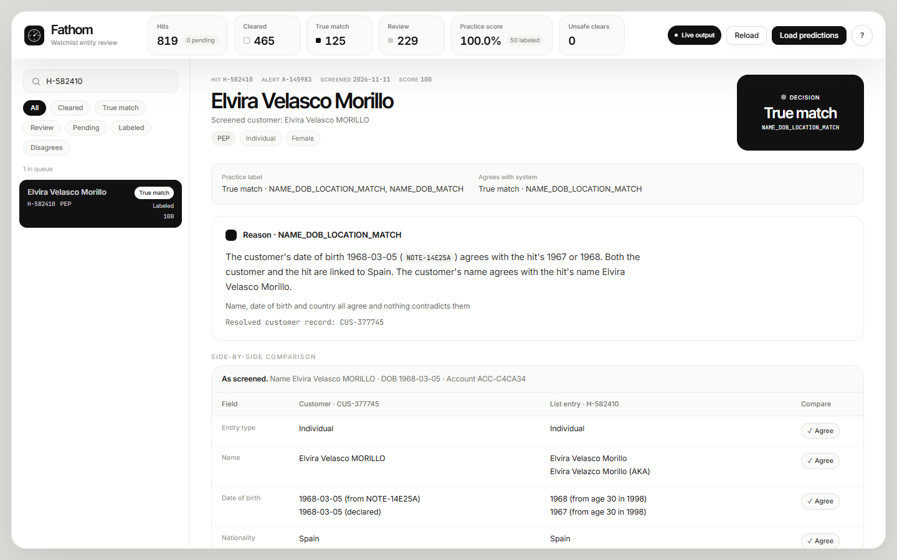
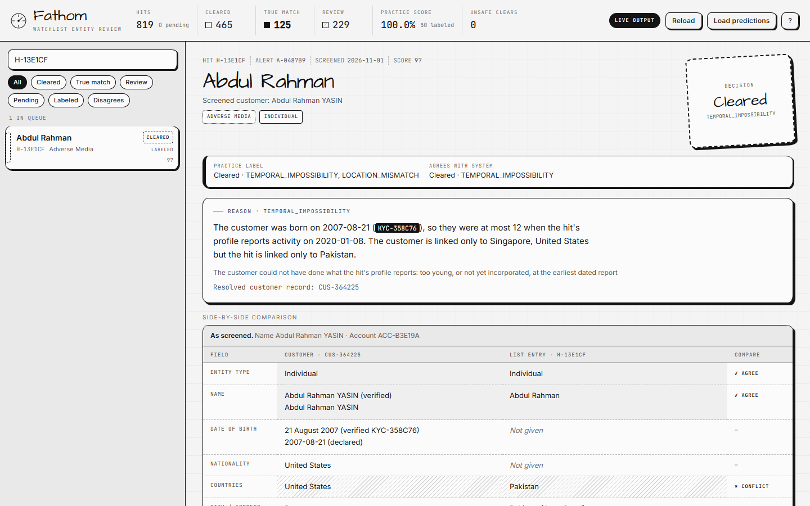
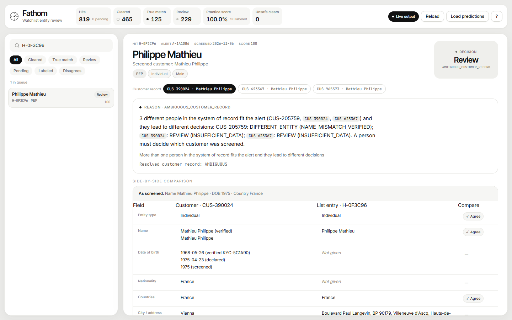
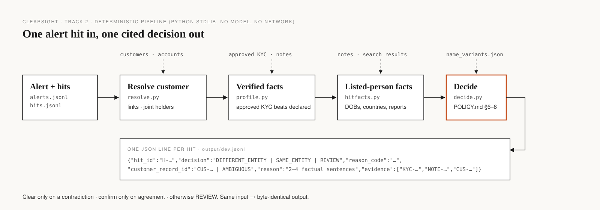

# Clearsight

**Clear the noise. Never clear a match.** Team Clearsight’s Track 2 sanctions-screening hackathon entry resolves customer records, compares watchlist evidence, and produces deterministic, cited decisions for analyst review. It runs locally with the Python standard library: no model, API key, or network access is needed. The slogan is our aim, not a guarantee; policy assumptions and parser limitations are documented in the [required system README](system/README.md).

|  |  |  |
| --- | --- | --- |
| **True match.** H-582410: name, DOB and Spain agree; every fact cites its record (NOTE-14E25A, CUS-377745). | **Cleared.** H-13E1CF: the customer was born in 2007, so was at most 12 at the hit’s 2020 report. | **Review.** H-0F3C96: three customers fit the alert and lead to different decisions, so a person decides. |

*Screenshots of the analyst desk (`ui/`), captured on an earlier run whose header shows 465 / 125 / 229; the current run gives 464 / 125 / 230 and the same decisions for these three hits.*

## Judges start here

| Read | What it gives you |
| --- | --- |
| [system/README.md](system/README.md) | The required deliverable: architecture, policy choices, evidence, three worked cases, honest limitations |
| [Judges' metrics](system/README.md#how-we-score-on-the-judges-metrics) and [Judge Q&A](system/README.md#judge-qa) | Measured unsafe clearances, clearance precision, same-entity recall and review rate on practice and shadow sets; short answers with file and function names |
| [deck/index.html](deck/index.html) | The pitch deck (open in a browser) |
| [deck/DEMO_SCRIPT_3MIN.md](deck/DEMO_SCRIPT_3MIN.md) | The timed 3-minute live demo script |
| [ui/screenshots/](ui/screenshots/) | All six analyst-desk screenshots |
| [output/dev.jsonl](output/dev.jsonl) | Our 819 submitted decisions |

**Proof points** (fresh run of `system/run` on the official `dev/` folder, scored with the organisers’ `validate.py`):

- **50/50 right decisions on the official practice labels, 0 unsafe clearances**; decision score 100.0, reason code and customer record right on all 50.
- **All 819 dev hits decided:** 464 clear (`DIFFERENT_ENTITY`) · 125 confirm (`SAME_ENTITY`) · 230 review (`REVIEW`), a 28% review rate. Output validity: 819 lines, 0 problems.
- **Python standard library only:** no model, no API key, no network, $0 per run, about 16 s for 819 hits on one laptop core.
- **Synthetic shadow sets** (559 hits each, seeds 7 and 21, formats dev never shows): score 0.965, 547/559 right, **0 unsafe**.
- **No rewording moves a decision towards clearing:** `tools/perturb.py` rewrites names, dates, ages and countries across the data room; every change it causes moves towards `REVIEW`.
- **Deterministic:** byte-identical output across runs and any `PYTHONHASHSEED`; 5 fresh-clone runs with different seeds give the same bytes.
- **Robustness under perturbation** (external test, 8 perturbed copies of dev): stripping accents, swapping name order, upper-casing hit, customer and KYC names, and rewriting ISO DOBs as "24 August 1994" changed **0 of 819** decisions. Deleting one letter in long name parts moved 19 decisions, 18 of them towards `REVIEW`; the one move to a clear is being fixed.

Practice and shadow scores are development feedback, not proof of unseen-set performance.

### Measured baseline: what the system saves over reviewing everything

Cost model from the brief, as implemented in [tools/score.py](tools/score.py): an unsafe clearance costs 60, a needless review 2–3. Each row is a real file scored with `python3 tools/score.py <predictions> dev/practice_labels.jsonl` on the 50 practice labels (10 REVIEW, 28 DIFFERENT_ENTITY, 12 SAME_ENTITY).

| Strategy on the 50 practice labels | Right | Unsafe clears | Cost | Score (1 − cost / review-all cost) |
| --- | --- | --- | --- | --- |
| Review every hit (the manual baseline) | 10 | 0 | 108 | 0.000 |
| Clear every hit | 28 | **22** | 1320 | 0.000 |
| Confirm every hit | 12 | 0 | 104 | 0.037 |
| Clearsight with `DOUBTFUL_LINK_REVIEW` on (see below) | 46 | 0 | 12 | 0.889 |
| **Clearsight as submitted** | **50** | **0** | **0** | **1.000** |

On the full dev set the system takes 589 of 819 hits (72%) off the analyst queue, each with a cited reason.

### Worked example: H-582410 → SAME_ENTITY

**Input.** Alert A-145983 screened “Elvira Velasco MORILLO”, DOB 1968-03-05, account ACC-C4CA34. The watchlist hit H-582410 is a Spanish PEP, “Elvira Velasco Morillo” (alias “Elvira Velazco Morillo”), with no `dobs` field; its profile notes say “November 1998 saw Elvira Velasco Morillo, a 30-year-old, face charges”, and its countries are Spain.

**What the system does.** ACC-C4CA34 is a joint account; the screened name and DOB pick customer CUS-377745. Her latest approved identity check, onboarding note NOTE-14E25A, verifies DOB 1968-03-05. “30 years old in November 1998” gives the hit a birth year of 1967 or 1968, so the dates agree; Spain is shared through the customer record; the names agree.

**Output** (the exact line in [output/dev.jsonl](output/dev.jsonl), which matches the practice label):

```json
{"hit_id": "H-582410", "alert_id": "A-145983", "decision": "SAME_ENTITY", "reason_code": "NAME_DOB_LOCATION_MATCH",
 "customer_record_id": "CUS-377745",
 "reason": "The customer's date of birth 1968-03-05 (NOTE-14E25A) agrees with the hit's 1967 or 1968. Both the customer and the hit are linked to Spain. The customer's name agrees with the hit's name Elvira Velasco Morillo.",
 "evidence": ["NOTE-14E25A", "CUS-377745"]}
```

> **Residual risk: what a perfect practice score does not prove**
>
> - **50 labels is a small sample.** 50/50 is a sanity check, not an accuracy estimate for the unseen set.
> - **Single-signal clears.** Counted from the reason codes in `output/dev.jsonl`: **217 of the 464 clears rest on location alone** (`LOCATION_MISMATCH` is the lowest-priority ground, so it is the code only when no other contradiction exists), and **79 rest on a verified name alone** (`NAME_MISMATCH_VERIFIED` with no country contradiction). Both follow the policy literally; some, such as bank branches abroad or names sharing a single part, deserve sampled QA. Examples are listed in [system/README.md](system/README.md#honest-limitations).
> - **Q: Why is `DOUBTFUL_LINK_REVIEW` off?** A: Policy principle 4 says verified beats declared: the approved check’s legal name outranks the record name, so a verified name that disagrees with the hit clears it. The practice labels read the policy the same way. A bank that wants to be stricter can flip one line in `decide.py`; that moves about 60 dev clears to review and adds no clears (practice then 46/50, score 0.889, measured above).

## Architecture



## 30-second quickstart

Needs Python 3.11 or newer; nothing to install. Tested on Python 3.11 and 3.13.5.

```sh
git clone https://github.com/Akin-Genc0/Track-2 && cd Track-2
system/run /path/to/dev output/dev.jsonl        # about 16 s, stdlib only, no key, no network
python3 /path/to/validate.py --data /path/to/dev --output output/dev.jsonl --score /path/to/dev/practice_labels.jsonl
make test                                       # data-free policy, loader and packaging tests
```

`make test` runs these, which you can also run directly:

```sh
python3 tests/test_policy.py          # 27 synthetic rare-situation policy cases
python3 tests/test_ages.py
python3 tests/test_textutil.py
python3 tests/test_loader.py
python3 tests/test_runner_boundary.py
python3 tests/test_real_format.py
python3 tests/test_packaging.py
python3 -m py_compile system/*.py
```

**Check determinism yourself:** run it twice and compare hashes (on macOS use `shasum -a 256`). The two hashes must match; we don't print a hash here because the output changes as fixes land.

```sh
system/run /path/to/dev /tmp/run1.jsonl && system/run /path/to/dev /tmp/run2.jsonl
sha256sum /tmp/run1.jsonl /tmp/run2.jsonl output/dev.jsonl
```

`system/run` works from any working directory and with spaces in either path. It reads only the data folder it is given and writes one JSON line per hit. If the data folder or its `hits.jsonl` is missing, or `hits.jsonl` has no readable hit records, it stops with exit code 2 and a clear message and writes no output file.

## How it works

```
 alerts.jsonl ─┐
               ▼
 ┌──────────────────────────┐   accounts / logins / emails → customers.jsonl
 │ 1. Resolve the customer  │   joint holders split by screened name + DOB;
 │    resolve.py            │   no link → name, DOB, country, city; >1 person → AMBIGUOUS
 └────────────┬─────────────┘
              ▼
 ┌──────────────────────────┐   accounts → onboarding → kyc_checks (approved only),
 │ 2. Profile the customer  │   email → notes; verified beats declared;
 │    profile.py            │   every fact carries the record IDs it came from
 └────────────┬─────────────┘
              ▼
 ┌──────────────────────────┐   names + aliases, entity type, DOBs, countries, death date,
 │ 3. Profile the listing   │   ages in profile text ("aged 45 in March 2019"),
 │    hitfacts.py           │   search results only when tied to this listing
 └────────────┬─────────────┘
              ▼
 ┌──────────────────────────┐   contradiction → DIFFERENT_ENTITY (DOB, temporal, location,
 │ 4. Decide (POLICY.md)    │   verified name, entity type, deceased); agreement with no
 │    decide.py             │   contradiction → SAME_ENTITY; anything else → REVIEW
 └────────────┬─────────────┘
              ▼
 ┌──────────────────────────┐   2–4 sentences from this hit's own facts;
 │ 5. Explain  explain.py   │   evidence = only the deciding record IDs
 └────────────┬─────────────┘
              ▼
       output/dev.jsonl
```

Full detail, three worked cases and honest limitations: [system/README.md](system/README.md).

## Safety design: REVIEW when unsure

An unsafe clearance costs 60; a needless review costs 2–3. The system is built around that asymmetry:

- **Clear only on a stated contradiction.** `DIFFERENT_ENTITY` needs a positive policy ground backed by cited records. Missing data is never a mismatch, and a year-only DOB still agrees with a full date.
- **Verified beats declared.** Rejected, failed or expired KYC checks are ignored, never used as evidence.
- **Ambiguity stays open.** If two plausible customers lead to different answers, the hit goes to `REVIEW / AMBIGUOUS_CUSTOMER_RECORD`. No customer found means `REVIEW` with `null`.
- **Fail closed.** Any exception, unreadable source or unparsed phrasing falls back to `REVIEW`, never to a clearance, and every hit still gets a line.
- **Tested against drift.** Rewording, schema-mutation and red-team tests (`tools/perturb.py`, `tools/unseen_sim.py`, `redteam/`) check that no change moves a decision towards clearing.

## Team Clearsight

- **Zain**: resolver, policy engine, evaluation tooling
- **Akin Genc** (`Akin-Genc0`): analyst desk UI, decision traces, docs
- **John Katsikis**: team member

## Full local workflow

Use Python 3.11 or newer and run these commands from the repository root. **The dataset is for event participants only and must never be committed.** Obtain the official development folder from the event organisers and place it at `dev/` (already gitignored):

```sh
system/run dev output/dev.jsonl
python3 tools/score.py output/dev.jsonl dev/practice_labels.jsonl -v
python3 tools/check_submission.py output/dev.jsonl dev
# If you have the organisers' validate.py and output.schema.json:
# python3 validate.py --data dev --output output/dev.jsonl --score dev/practice_labels.jsonl
make test
python3 ui/serve.py
```

Open http://127.0.0.1:8765/ for the analyst desk; stop the server with Ctrl-C. In another terminal, open the pitch:

```sh
open deck/index.html  # macOS; otherwise open this file in your browser
```

`make run score test` runs the same sequence against `dev/`; `make ui` starts the desk and `make deck` opens the pitch. Running the system regenerates the required `output/dev.jsonl` deliverable. You can run `make test` without any dataset.

Workbook conversion is optional. If you only have `Screening Dev Set - browse.xlsx`, place it in the repository root (gitignored) or set `TRACK2_XLSX` to its path, then run `python3 tools/xlsx_to_dev.py` (writes `data/dev/`) and pass `DATA_DIR=data/dev` to Make. The converter searches `$TRACK2_XLSX`, then `./Screening Dev Set - browse.xlsx`, then `~/Track-2-data/Screening Dev Set - browse.xlsx`.

## Repository map

| Path | Purpose |
| --- | --- |
| [system/README.md](system/README.md) | Required deliverable: architecture, policy decisions, evidence and limitations |
| [system/](system/) | Screening implementation and executable `run` entry point |
| [output/dev.jsonl](output/dev.jsonl) | Submitted development predictions |
| [deck/](deck/) | Pitch deck; start at [index.html](deck/index.html) |
| [ui/](ui/) | Local analyst review desk |
| [tests/](tests/) | Synthetic policy regression cases |
| [tools/](tools/) | Workbook conversion, local scoring and perturbation checks |
| [FORMAT.md](FORMAT.md) | Input/output format reference |
| `dev/` | Official development inputs (ignored by Git; never commit) |
| `data/dev/` | Optional workbook reconstruction (also ignored by Git) |

## Evaluation

Run the synthetic policy tests independently of the dataset. The local scorer compares predictions with the official practice labels, reporting decision accuracy, unsafe clearances, cost relative to reviewing every hit, reason-code/customer agreement and evidence overlap. Practice-set results are development feedback, not proof of unseen-set performance or real-world safety. See [system/README.md](system/README.md) for detailed evaluation and limitations. Optional robustness checks: `python3 tools/perturb.py dev`.

GitHub Actions runs only data-free policy tests and Python syntax checks on Python 3.11. It never needs the workbook or participant data. Participants can run the full pipeline locally using the quickstart above.

## License

The code is licensed under [MIT](LICENSE). The organisers’ workbook and third-party media remain subject to their respective rights; this code license does not grant rights to those assets.
